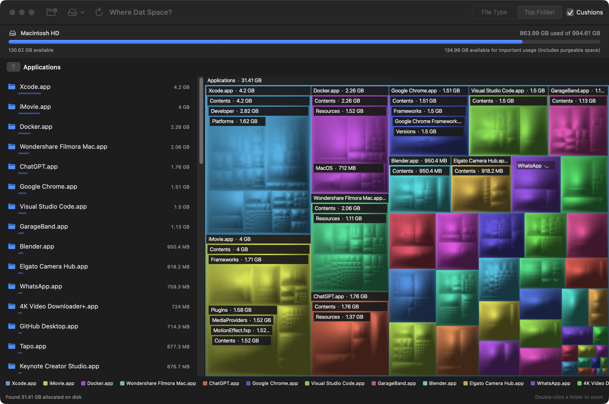

#  Where Dat Space?

A little disk-space detective for the Mac, part of [Mikerosoft](https://mikerosoft.app).

macOS 14 or later

<!-- media: hero -->

<!-- /media: hero -->

## What it is

My 1 TB MacBook kept filling up, so I wanted the GrandPerspective / WinDirStat sort of map I remembered. Big files get big rectangles, and I can zoom in to see what's eating the disk.

## Using it

Choose a folder with **⌘O**, or use **Scan Home** or **Scan Whole Disk**. Whole Disk scans `/System/Volumes/Data` so the same folders don't appear twice through macOS firmlinks. The last folder is remembered, and **⌘R** rescans it.

Hover for a path, allocated size and percentage of the current view. Click to select in the map and size-sorted sidebar. Double-click a folder to zoom in, then use a breadcrumb, **Escape** or **⌘↑** to go back up. Colours can follow file type or top folder. **Cushions** switches the soft shading on and off.

Right-click a file or folder to reveal it in Finder, copy its path or move it to Trash. **Move to Trash** asks for confirmation and shows the full path and allocated size. You can restore the item from Trash. Grouped smaller files can't be trashed together from the app; open their parent folder in Finder to inspect them.

## Get it

Paste this into your AI coding agent (Claude Code, Codex, Cursor...):

> Fork https://github.com/mikecann/where-dat-space to my GitHub account and clone my fork (if I don't use GitHub, or want to keep my copy private, just clone it instead), then make it my own. It's one of Mike Cann's personal tools, so read the README first, change anything specific to his setup to suit mine, then help me get it running.

### Or set it up by hand

You'll need macOS 14 or later, Git, and Xcode or Command Line Tools with Swift 6 or later. If needed, run `xcode-select --install` first. No API keys, backend or network connection are needed to use the app.

```bash
git clone https://github.com/mikecann/where-dat-space.git
cd where-dat-space
bash restart.sh
```

That makes a release build, installs `~/Applications/Where Dat Space.app`, links `~/.local/bin/where-dat-space` to its executable and opens it. Add `~/.local/bin` to your PATH if it isn't already there. The script builds a macOS `.icns` from the mascot PNG and signs with the first available Apple Development identity, falling back to ad-hoc signing. It isn't notarised. If `iconutil`'s conversion service is unavailable in a sandbox, the script packs the same resized PNGs into an `.icns` directly.

The bundle ID is `com.mikerosoft.where-dat-space`, with a stable designated signing requirement so privacy grants can survive rebuilds. Keep using the installed bundle when checking permissions. macOS may still ask you to re-add it after changing signing identities.

`WHERE_DAT_SPACE_APP_PATH` and `WHERE_DAT_SPACE_CLI_PATH` override the full bundle and CLI link paths. `WHERE_DAT_SPACE_CODESIGN_IDENTITY` overrides the signing identity (`-` for ad-hoc). Set `WHERE_DAT_SPACE_OPEN=0` to install without opening a window. For example, to keep an install inside this clone:

```bash
WHERE_DAT_SPACE_APP_PATH="$PWD/build/Where Dat Space.app" \
WHERE_DAT_SPACE_CLI_PATH="$PWD/build/bin/where-dat-space" \
WHERE_DAT_SPACE_OPEN=0 bash restart.sh
```

`bash uninstall.sh` removes the installed app and its owned CLI link. Pass the same path overrides if you used custom locations. It leaves unrelated apps and commands alone.

## Headless commands

```bash
where-dat-space --scan /Applications
where-dat-space --render /Applications --out applications.png --size 1600x1000 --color type
where-dat-space --render /Applications --out folders.png --color folder
where-dat-space --open /Applications
```

`--scan` prints allocated bytes, file and folder counts, retained nodes, unreadable folders, duplicate hard links, elapsed time, peak memory and the 15 largest top-level children. `--render` prints the same summary and writes a PNG with the app's treemap renderer. Neither opens a window or changes the scanned files. Image dimensions default to 1600×1000 and can range from 64 to 8192 per side. `--open` opens the app and scans that folder; `--help` lists the flags.

For development, use `swift run WhereDatSpace` or `.build/release/WhereDatSpace` with the same flags.

## Full Disk Access

Some folders won't let us in. A scan carries on and lists unreadable folders, with an **Open Full Disk Access** button. In **System Settings > Privacy & Security > Full Disk Access**, add **Where Dat Space?**, turn it on, then rescan. Some protected folders can still be unreadable. For headless runs, your terminal or agent may also need access.

The scanned total can differ from the volume's used space because of skipped folders, APFS snapshots, filesystem metadata and clones sharing blocks. The volume bar also shows space available for important usage, which includes purgeable space.

## How it works

The app measures **allocated bytes on disk**, so sparse and compressed files reflect their allocated storage. Hard links count once, attributed to the first link encountered. It doesn't follow symlinks or cross into other volumes. APFS clone extents can't be deduplicated through file allocation metadata.

A small C scanner uses `getattrlistbulk` with up to sixteen workers, with a `readdir` / `fstatat` fallback. Files below **512 KiB allocated** are folded into a mixed entry per directory. The squarified layout fits the rectangles together, and cushion shading makes the nesting easier to see. A cached Core Graphics image keeps hovering and selection light.

## Development

```bash
swift build
swift test
bash -n restart.sh uninstall.sh
```

In a restricted agent sandbox, set `CLANG_MODULE_CACHE_PATH` and `SWIFTPM_MODULECACHE_OVERRIDE` to `$PWD/.build/module-cache`, then use `swift build --disable-sandbox` and `swift test --disable-sandbox`. The installer does this for you.

See [AGENTS.md](AGENTS.md) for code layout and window-only screenshot commands.

MIT licensed. See [LICENSE](LICENSE).
